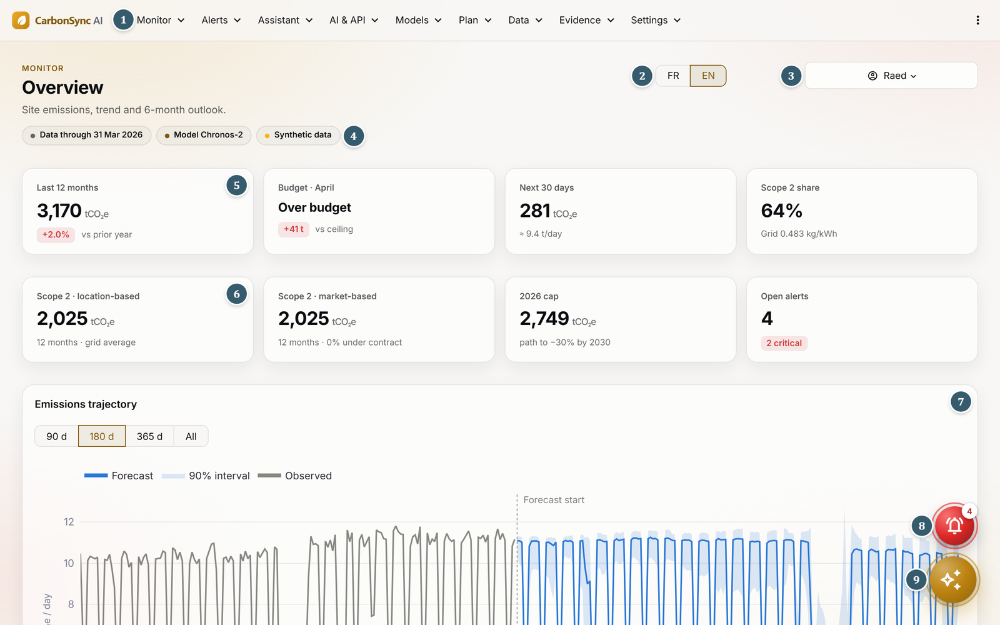
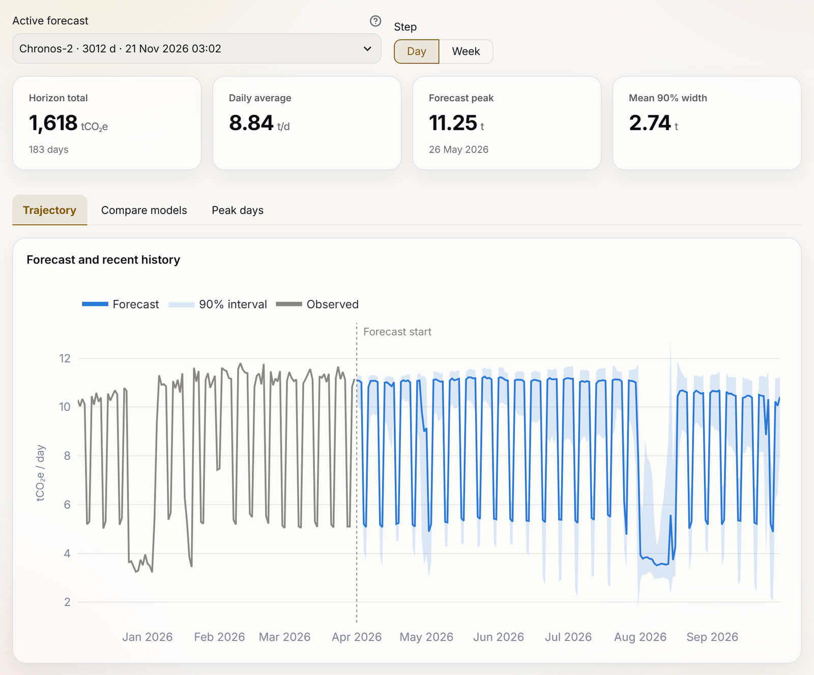
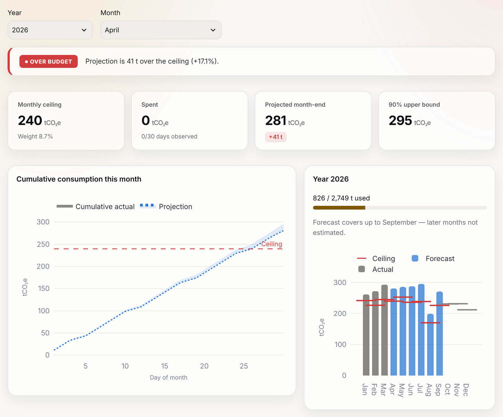
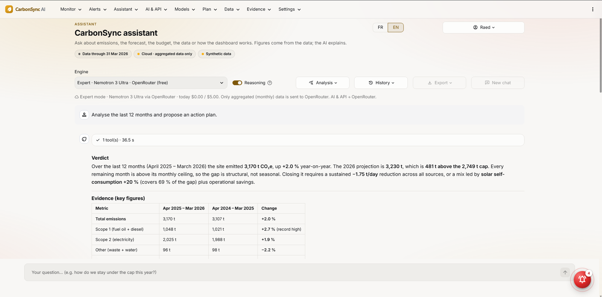
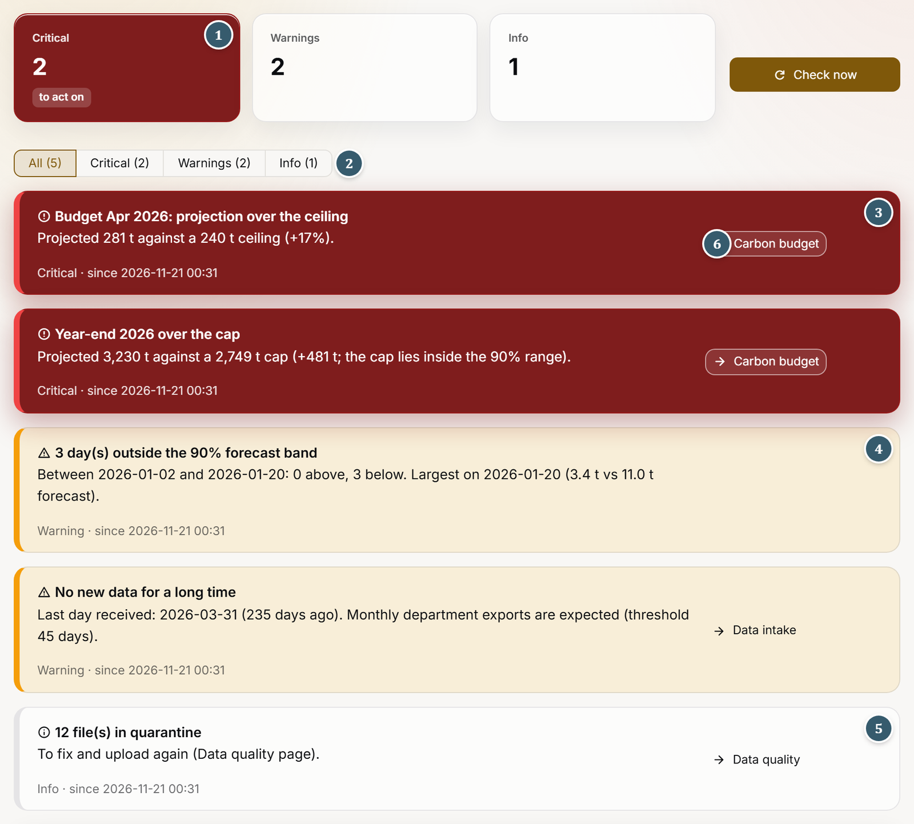

# CarbonSync AI

Greenhouse-gas monitoring, a 6-month emissions forecast and reduction planning for an industrial site, with an AI
assistant that explains the figures. Streamlit + DuckDB, forecasts by **Chronos-2** (Prophet as fallback).

> ⚠️ **All data in this repository is synthetic** (seed 42): eight generated years (2018–2025) plus the first quarter
> of 2026 for a fictional wiring-harness plant. No real site data, no user accounts and no API keys are included.



| Document | What it covers |
|---|---|
| [**Master's thesis (PDF, 52 pages)**](docs/CarbonSync_AI_final_report.pdf) | Context, data, the four-model benchmark, the dashboard, the AI assistant, results |
| [**Architecture**](docs/ARCHITECTURE.md) | How the code fits together: start-up, the 7-step pipeline, where the models run, the assistant, where data is kept |
| [**Full project report**](docs/CARBONSYNC_REPORT.md) | Every page and figure, the target and budget, the GHG inventory, alerts, login, settings |
| [**Credits**](CREDITS.md) | The original project this remake is inspired by, its author and how to cite it |

## Credits

> **This project is a remake inspired by _YAP-T CarbonSync_ and _CarbonSyncAI_, originally designed and developed by
> [Hamdi Abdeljawed](https://github.com/hamdi-abdeljawed) as his Master's thesis at the Institute of Technological
> Studies of Bizerte (2025).** All credit for the original concept, design, implementation and research goes to him.

- **Original repository:** [github.com/hamdi-abdeljawed/YAP-T-CarbonSync-1](https://github.com/hamdi-abdeljawed/YAP-T-CarbonSync-1)
- **Original work:** a carbon-tracking web application and an AI module (Prophet emission forecasts, predictive
  maintenance, an NLP chatbot) on React and Flask. This remake rebuilds the idea from scratch in Python
  (Streamlit, DuckDB, Chronos-2, an LLM assistant) on synthetic data.
- **People, acknowledgement and how to cite the original thesis:** [CREDITS.md](CREDITS.md)

This remake is independent: it is not affiliated with or endorsed by the original author, his host company or the
institute.

## What it does

- **Monitor** daily emissions (Scope 1 fuel oil and diesel, Scope 2 electricity, waste and water) from four
  department exports, with validation and repair of messy CSV files.
- **Forecast** 183 days ahead with a 90 % interval: Chronos-2 from 60 days of history, otherwise Prophet; a rolling
  backtest scores every model.
- **Plan**: a −30 % by 2030 target, a yearly carbon budget split by month, what-if scenarios (solar, efficiency,
  volume), a GHG inventory (Scope 2 location- and market-based, Scope 3 screening) and a breakdown by plant zone.
- **Alert** on budget overruns, days outside the forecast band, missing department data and quarantined files.
- **Ask** an assistant in French or English: a built-in analysis engine, local models through Ollama (nothing leaves
  the PC) or cloud models with your own keys (only monthly aggregates are sent).
- **Report**: an Excel audit workbook and a 3-page PDF brief after each data update. Viewer / editor / admin roles.

| Forecast | Carbon budget |
|---|---|
|  |  |
| **AI assistant** | **Alerts** |
|  |  |

## What is in this repository

| Included | Not included (created on your PC) |
|---|---|
| The code (`app/`, `src/`), 341 tests, the documents above | `data/carbonsync.duckdb` and the reports: built by the pipeline (Quick start) |
| `data/inbox/`: 399 raw monthly CSV exports from 4 departments, Jan 2018 – Mar 2026, about 10 % with realistic defects | User accounts: the first start asks you to create the administrator |
| `data/truth/`: the clean ground truth the generator started from | API keys: kept in your operating system's credential store, never in the project |
| `samples/`: ready-to-upload files (Q1, Q2 and Q3 2026 zips, April test files) | Assistant conversations and usage (`data/assistant/`) |

## Quick start

Python 3.11 or newer (tested with 3.12).

```powershell
git clone https://github.com/mogaadiraed/personal-projects.git
cd personal-projects/carbonsync.ai
python -m venv .venv
.venv\Scripts\activate            # Linux/macOS: source .venv/bin/activate
pip install -r requirements.txt

$env:PYTHONPATH = "src"           # Linux/macOS: export PYTHONPATH=src
python -m carbonsync.pipeline --no-backtest   # build the database from the raw CSVs (about 1 minute)

streamlit run streamlit_app.py    # or double-click start.bat / ./start.sh (the window shows the activity)
stop.bat                          # stops the dashboard, its background work, the local models and Ollama
```

To download only this project: `git clone --filter=blob:none --sparse <URL>`, then
`git sparse-checkout set carbonsync.ai` inside `personal-projects`.

The first forecast downloads the Chronos-2 weights (`amazon/chronos-2`, about 460 MB) from Hugging Face once; they
run on the CPU. Drop `--no-backtest` to also score the models (rolling backtest, a few more minutes): the Methodology
and Model lab pages then show your own scores. Try the upload loop with `samples/2026-Q2.zip` on **Data → Data
intake**.

Open http://localhost:8501. **First start**: the dashboard asks you to create the administrator account; it can
then create viewer and editor accounts (Configuration → Users, or `python -m carbonsync.auth add <name> --role editor`).
Language: **FR / EN** switch at the top right of each page, next to your account button (team online / offline, latest data files, log out). The round alert button sits above the AI button at the bottom right (red when an alert is critical). Look and layout: **Settings → Configuration** (palette, glass or flat, light / dark, text size, pages in the menu).

The AI assistant works without any key (built-in engine). For local models install [Ollama](https://ollama.com)
and pull a model; for cloud models add your own key on the **AI & API** pages (see [Assistant](#assistant)).

The terminal running `streamlit run` shows what happens in the background, live: page views, database reads,
every model fit / inference (with timings), router decisions and each pipeline step.

```
21:35:13 | INFO  | pipeline             | 4/7 Forecast with the router (Chronos-2 from 60 days of history)...
21:35:13 | INFO  | models.ensemble      | Router: 3012 days of history >= 60 -> Chronos-2
21:35:14 | INFO  | models.chronos_model | Chronos-2 inference done (0.20 s) -> mean 8.84 t/day
21:35:14 | INFO  | pipeline             | 5/7 Backtest refresh (new data since the last one)...
21:36:02 | INFO  | pipeline             | 6/7 Alerts check...
```

The same lines stream into the dashboard while a model or the pipeline runs.

## Assistant

**Assistant** (top bar, after Monitor) answers questions about emissions, the forecast, the budget, data quality,
the models and how the dashboard works, in French or English.

- Every figure comes from **13 read-only tools** (overview, emissions by period, period comparison, forecast,
  budget, data quality, pipeline history, model scores, methodology, dashboard guide, what-if scenario, analysis).
  The model only explains. Each answer shows the tools used, charts built from their results and a
  **Sources** panel (data date, forecast run, model, tokens, time).
- **Analysis**: hotspots of the last N months vs last year, why they changed (LMDI: volume vs intensity), the
  full-year projection against the cap, the reductions needed (kWh/day, L/day, %) with a feasibility label, the
  ranked levers and an action plan. Also in the terminal: `python -m carbonsync.assistant [--lang en] [--months 6]`.
- **Engines**: a local model through [Ollama](https://ollama.com) on the GPU (nothing leaves the PC), the
  **Expert mode** (cloud models with your own keys: DeepSeek, Kimi, GLM, Mistral through Ollama Cloud, free
  models such as NVIDIA Nemotron and Google Gemma through OpenRouter, or Claude through the Anthropic API;
  aggregated data only), or the
  **built-in assistant** (no model, guided questions, exact figures), which also takes over whenever a model
  is unavailable.
- **Figure check**: every number in an answer is looked up in the data the assistant read; numbers that are
  not found are listed under the answer.
- **Floating assistant**: a round AI button at the bottom right of every page opens the same conversation in a
  panel over the page. It knows the page (suggestions for that page, "explain this page") and has a shortcut to
  the Assistant tab.
- **Export**: the whole conversation, or only the last answer (the action plan), as Markdown or PDF, with each
  answer's sources.

```powershell
winget install Ollama.Ollama        # once
ollama pull qwen3.5:9b              # recommended (≈6.6 GB); qwen3.5:4b (≈3.3 GB) is faster
```

**AI & API → Ollama → Local Ollama** has **Stop local models** (unloads every model to free the GPU; the server
stays open, the assistant no longer loads a model by itself) and **Start** (loads the default model now, opening
Ollama if it is closed). A local model also leaves the GPU by itself 20 minutes after its last question.
**Local model evaluation** (terminal): `python -m carbonsync.assistant.evaluation --models qwen3.5:9b qwen3.5:4b`
asks 30 FR/EN questions with known answers to each model and scores it (right tool, expected figures, unsourced
figures, language, time); when no default model is saved, the best one is used.

Conversations are saved locally in `data/assistant/chats/` and evaluation results in `data/assistant/eval/`
(both git-ignored).

### Expert mode (cloud models with your own keys)

The **AI & API** pages hold one page per provider. Keys go to the **Windows Credential Manager** (`keyring`),
never to `config.yaml`, git, logs, exports or conversations, and are only shown masked. One daily spending cap
(default $5, **AI & API → AI overview**) covers every cloud provider.

- **Ollama Cloud** (**AI & API → Ollama**): create a key at ollama.com/settings/keys, paste it, **Test the
  connection** (reads the account balance, free). Pick one of the top 5 cloud models (DeepSeek V4 Pro by default,
  Kimi K3.1 Pro, GLM 5.3, Mistral Large 4, DeepSeek V4.1 Flash) or any other Ollama cloud model; **Quick test**
  checks it answers. Ollama Cloud is paid per token (`OLLAMA_API_KEY` is used when no key is stored).
- **OpenRouter** (**AI & API → OpenRouter**): create a key at openrouter.ai/settings/keys (`sk-or-v1-…`),
  **Test the connection** (reads the key and today's free quota, no model request). Pick one of the top 5 free
  models (NVIDIA Nemotron 3 Ultra by default, Google Gemma 4 31B, NVIDIA Nemotron 3.5 Super VL, inclusionAI
  Ling 3.2 Flash, Google Gemma 4 26B A4B) or any other free model with tools. Free models cost nothing but are
  limited to 20 requests/min and 50/day (1,000/day once 10 credits have been bought); a question takes 2 to 4
  requests. Options: automatic fallback to the other free models, deny providers that collect data
  (`OPENROUTER_API_KEY` is used when no key is stored).
- **Claude** (**AI & API → Claude**): create a key in the Claude console (platform.claude.com → API Keys), pick
  the model (Opus 5.5 default, Sonnet 5.5, Haiku 5.5) and the reasoning effort (`ANTHROPIC_API_KEY` is used when
  no key is stored). Server-side fallback is on for Opus and Sonnet: if Claude declines a request for policy
  reasons, Anthropic retries it on another Claude model.
- In **Assistant → Engine**, choose an **Expert · …** engine (the 5 Ollama Cloud models, the 5 OpenRouter free
  models and Claude are listed once their key is stored).

Every cloud model first reads the **expert brief** [`docs/assistant/expert_brief.md`](docs/assistant/expert_brief.md)
(role, site, data, metrics, tools, working and answering rules). To onboard a new provider or model, add it to
`src/carbonsync/assistant/providers/registry.py` and build its system prompt with
`prompts.system_prompt(ctx, lang, mode="expert")`. Expert mode only receives monthly or coarser aggregates
(periods are widened to whole months), never results read in local mode. Each answer's Sources panel shows its
estimated cost and what was sent.

## Model lab

**Models → Model lab** trains Prophet, Chronos-2 and/or Ens-PC on the window you choose:

- horizon **3 / 6 / 12 months**, training period **6 / 12 / 24 months or all history**;
- **Backtest on the past**: pick the last training day; the forecast is scored against the real data
  (MAE, MASE, 90 % coverage, bias, total error) next to a seasonal-naive baseline;
- **Forecast the future**: trains up to the last observed day; any result can be saved as the active forecast;
- **How it works**: Prophet's learned trend / weekly / yearly components, the context Chronos-2 reads and its
  quantile fan, and how Ens-PC averages the two;
- every run of the session is kept in **History** to compare windows.

## Data intake (new data → whole loop)

**Data → Data intake** accepts department CSVs:

- one drop zone per department (Energy, Production, Logistics, Waste & water) with a CSV template;
- **one drop zone for everything**: many CSVs, a `.zip`, or a whole folder; the department is recognised from the
  file-name prefix (`energie_`, `production_`, `logistique_`, `dechets_eau_`) or from the columns.

**Ingest and rerun the pipeline** then runs the full loop with a live log:
save to `data/inbox/` → validate & repair → DuckDB → daily emissions → forecast with the router
(**Chronos-2 from 60 days of history, otherwise Prophet**) → backtest refresh → alerts check → Excel and PDF
reports. Every page then shows the new data.
The run happens in the background: you can leave the page, it carries on and every page updates when it ends.
If the forecast is ever older than the data (a run stopped halfway), the Overview and Forecast pages say so
and offer **Update the forecast**; the Overview never draws forecast days over days that have real data.
A month reported by only some departments waits until all of them have sent it (shown as *Waiting*).
**Back to the original data** removes all uploads and restores any replaced file.

Ready-made files to try it: `samples/` (regenerate with `python scripts/make_sample_uploads.py`).

| Folder | Content | Expected result |
|---|---|---|
| `samples/2026-Q1.zip` | Jan–Mar 2026, 4 departments (12 CSVs); already in `data/inbox/` in this repository | no change (same files) |
| `samples/2026-04_mixed/` | April: French-format energy file, clean logistics & waste, production file missing a column | energy repaired, production quarantined, April *waiting* |
| `samples/2026-04_correction/` | corrected April production file | April complete once waste & water is also there |
| `samples/2026-Q2.zip` | Apr–Jun 2026, 4 departments (12 CSVs), continues Q1 | +91 days, data through 30 Jun 2026, new Chronos-2 forecast |
| `samples/2026-Q3.zip` | Jul–Sep 2026, 4 departments (12 CSVs), continues Q2 (August holiday shutdown) | +92 days, data through 30 Sep 2026, new Chronos-2 forecast |

Command line equivalent: `python -m carbonsync.pipeline` (options `--no-forecast`, `--no-report`, `--no-backtest`,
`--backtest` to force it). Alerts only: `python -m carbonsync.alerts`.

## Rebuild the data (optional)

```powershell
$env:PYTHONPATH = "src"
python -m carbonsync.synth.generator   # 1. synthetic data
python -m carbonsync.synth.messify     # 2. inject realistic defects
python -m carbonsync.ingest.load       # 3. validate + load into DuckDB
python -m carbonsync.features.daily    # 4. daily table + emissions
python -m carbonsync.models.ensemble   # 5. forecast
python -m carbonsync.backtest.rolling  # 6. backtest
```

The generator writes 2018–2025; add the 12 files of `samples/2026-Q1.zip` to `data/inbox/` to get the data shipped here.

Then run the tests: see [Tests](#tests).

## Settings and look

**Settings → Configuration** has up to nine tabs, depending on the role: Appearance, Layout, Target & budget,
Inventory & breakdown, Factors, Reports & alerts, Users, System (router and backtest included), Password (everyone).

## Target, inventory, breakdown, alerts, login

- **Target and path** (`targets:` / `budget:` in config.yaml): base year 2019, −30 % by 2030; each year's cap is
  read on the straight-line path (2026: 2,749 tCO₂e) and split by month with the site's seasonal profile
  (last 3 complete years). A fixed cap and hand-entered weights remain possible.
- **Scope 2 market-based** (`scope2:`): contractual instruments (PPA, green tariff, certificates) and a residual mix.
  No contract is recorded and Tunisia has no published residual mix, so market = location-based for now.
- **Scope 3 screening** (`scope3:`): the 15 categories, each calculated / estimated / excluded with its reason
  (copper and PVC per unit, upstream energy, transport, commuting are estimates from sourced assumptions).
- **Breakdown** (`breakdown:`): zones P1 cutting, P2 preparation, P3 assembly, utilities, logistics, and items, from
  allocation keys per meter; the zones add up to the site total. Keys are estimates until sub-meters exist.
- **Alerts** (`alerts:`): budget amber/red, year-end over the cap, actual days outside the 90 % band, departments not
  sending data, router drift, quarantine; checked after each pipeline run, saved in `data/alerts.json`, shown as a
  round button above the AI button (red when critical) and on the Alerts page (critical alerts on dark red).
  Email is not configured.
- **Login and roles** (`auth:`): viewer / editor / admin; PBKDF2-SHA256 password hashes in `data/auth/users.json`
  (git-ignored), 12-hour sessions, lock after 5 failures. `auth: enabled: false` (or `CARBONSYNC_AUTH=off`) switches
  it off. Users from the command line: `python -m carbonsync.auth list | add | passwd | role | unlock | delete`.

- Appearance and layout are stored in `config.yaml` (`appearance:`, `layout:`, `reports:`), with the usual
  audit copy in `data/config_history/`.
- The theme sections of `.streamlit/config.toml` are rewritten from them (server, browser and client sections
  are kept). Streamlit watches that file, so a new palette applies without a restart.
- Every palette (and any custom colour) is fitted so text, accent and button labels pass the contrast checks
  in both modes, on flat and frosted cards.
- Chart series colours never follow the palette: they stay fixed per entity and switch to the dark-mode steps
  of the same hues on a dark page (checked with a colour-blind validator).
- Glass effect: palette glows behind the page, slowly drifting when **Animated background** is on (transform-only
  animation; off with Animations or the system's reduced-motion setting).
- Emission factors stay read-only in the app: changing them changes every past figure.

## Tests

```powershell
python -m pytest -o pythonpath="src ." tests/ -q
ruff check src/ app/ tests/
```

Build the data first (Quick start). `test_backtest_duckdb_records_populated` also needs the rolling backtest in the
database: run `python -m carbonsync.pipeline --backtest` once, otherwise that one test fails (340 of 341 pass).

## Structure

```
carbonsync.ai/
├── streamlit_app.py      # Entrypoint
├── start.bat / start.sh  # One-click launchers: start, open the browser, show the activity in the window
├── stop.bat              # Stops everything: dashboard, background work, local models, Ollama (keep-ollama to leave it open)
├── config.yaml           # Emission factors, budget, model parameters
├── .streamlit/           # Server settings + theme (theme sections written from Settings → Appearance)
├── app/                  # Dashboard
│   ├── main.py           #   Navigation shell
│   ├── core/             #   Shared logic (budget re-export, language, login gate, page registry)
│   ├── data/             #   Cached DuckDB / JSON loaders
│   ├── pages/            #   One file per page
│   └── ui/               #   Appearance (palettes, logo drawn in the palette colour), theme CSS, components, charts, formatting
├── src/carbonsync/       # Pipeline: synth → ingest → features → models → backtest → scenarios → export
│   ├── pipeline.py       #   One-call refresh (inbox → … → forecast → backtest → alerts → reports)
│   ├── targets.py        #   Reduction target, yearly path, caps and seasonal weights
│   ├── budget.py         #   Monthly carbon budget (ceilings, status, year summary)
│   ├── inventory/        #   Scope 2 market-based, Scope 3 screening, breakdown by zone
│   ├── alerts.py         #   Alert checks and the saved alert state
│   ├── auth.py           #   Users, password hashes, sessions, roles (and its command line)
│   ├── obs.py            #   Console / live logging
│   ├── assistant/        #   Assistant: tools, analysis engine, tool loop, figure check, prompts,
│   │                     #   providers (registry; Ollama local + Cloud, OpenRouter on the OpenAI-compatible
│   │                     #   adapter, Claude, built-in), key vault, usage and cap, evaluation set,
│   │                     #   conversation export (Markdown / PDF)
│   ├── ingest/intake.py  #   Upload detection, saving, undo
│   └── models/lab.py     #   Model lab experiments
├── scripts/              # make_sample_uploads.py, stop_dashboard.ps1 (used by stop.bat)
├── samples/              # Ready-to-upload department CSVs (2026): Q1 / Q2 / Q3 zips, April test files
├── tests/                # Pytest suite
├── docs/                 # Thesis (PDF), ARCHITECTURE.md, CARBONSYNC_REPORT.md (full project report)
│   ├── assistant/        # Dashboard guide the assistant searches (FR / EN) and the expert brief
│   └── images/           # Screenshots used in this README
└── data/                 # inbox/ (raw synthetic CSVs) and truth/ are tracked; everything else is generated
```

## Pages

| Group | Page | What it answers |
|---|---|---|
| Monitor | Overview | Where are we, and where are we heading? |
| Monitor | Forecast | What does each model predict? Pick the active forecast, run a new one. |
| Monitor | Breakdown | Which plant zone and which item emits what? |
| Alerts | Alerts | What needs attention now (budget, year-end, anomalies, missing data)? |
| Assistant | Assistant | Ask anything about the data and the dashboard; analysis and action plan; export (Markdown / PDF). Also a floating AI button on every page |
| Models | Model lab | How does each model perform on the window I choose, and how does it work? |
| Plan | Carbon budget | Will this month stay under its ceiling, and is the year on the path to the 2030 target? |
| Plan | Scenarios | How much do solar, efficiency and volume change the outlook? |
| Data | Data intake | Upload new department CSVs and rerun the whole loop |
| Data | Data quality | What was accepted, repaired, rejected? |
| Evidence | GHG inventory | Scope 1, Scope 2 both methods, Scope 3 screening (ESRS E1-6) |
| Evidence | Methodology | How accurate are the models in backtest? |
| Evidence | Reports | Conclusions and recommendations on screen, 13-sheet Excel audit workbook, 3-page PDF summary, CSV exports |
| Settings | Configuration | Appearance, layout, target & budget, inventory & breakdown, emission factors, reports & alerts, users, system (router, export / import / reset) — tabs follow the role |
| AI & API | AI overview | Every provider's status, daily cap shared by cloud providers, usage, data sent, expert brief |
| AI & API | Ollama | Ollama Cloud key, top 5 cloud models (DeepSeek, Kimi, GLM, Mistral), quick test; local Ollama models with Stop / Start (free the GPU) |
| AI & API | OpenRouter | OpenRouter key, top 5 free models (Nemotron, Gemma, Ling), free limits, fallback, data-collection filter, quick test |
| AI & API | Claude | Claude API key (Windows Credential Manager), model, reasoning effort |

## License

[MIT](LICENSE) © 2026 Raed Mogaadi. The original project's credits are in [CREDITS.md](CREDITS.md).
